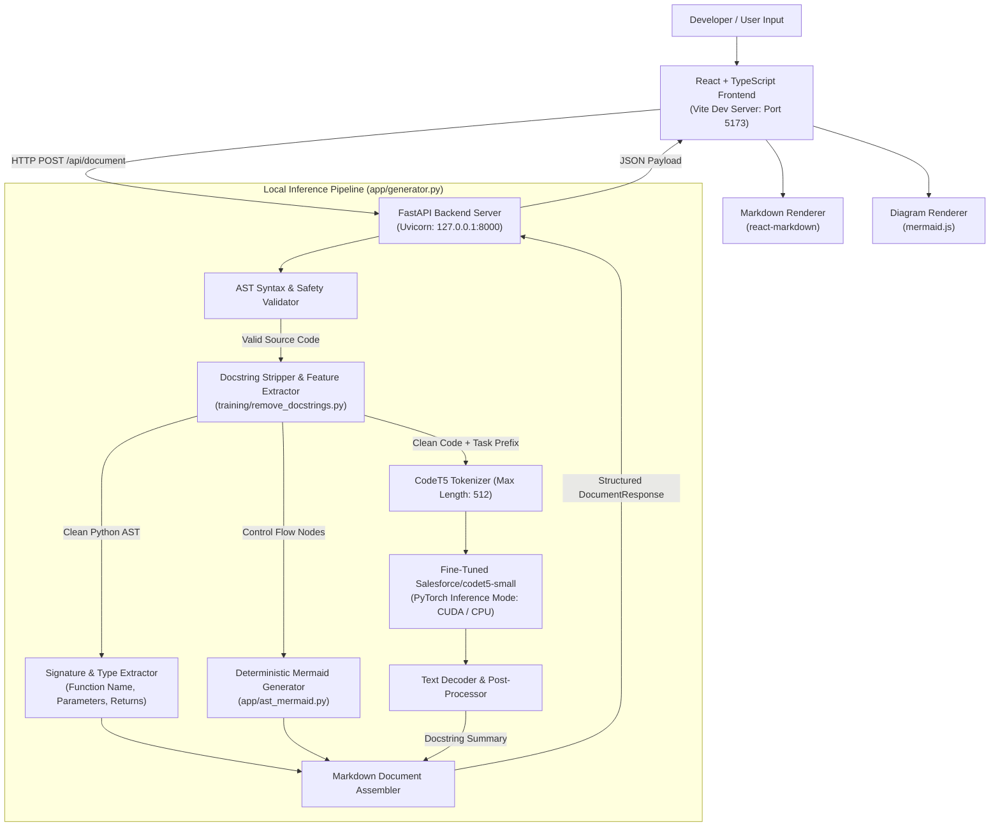

# CODEscribe — Automated Python API Documentation & Flowchart Generator

> **MCA Final Year Academic Project**
> An offline, privacy-first developer tool that leverages a locally fine-tuned **`Salesforce/codet5-small`** Large Language Model to synthesize structured Markdown API documentation, accompanied by deterministic Abstract Syntax Tree (AST) control flow diagrams.

---

## 1. Project Overview

Software documentation often lags behind code implementation due to the manual overhead of drafting and maintaining accurate technical references. **CODEscribe** addresses this problem by providing an automated, privacy-preserving pipeline that translates Python function implementations into natural-language API documentation and visual control flowcharts.

Unlike cloud-dependent documentation tools that transmit proprietary code over the internet to commercial APIs, CODEscribe runs **100% locally on consumer hardware** (optimized for modern NVIDIA GPUs with CPU fallback). It combines:
1. **Generative Modeling:** A fine-tuned sequence-to-sequence Transformer (`Salesforce/codet5-small`) that infers function intent and writes natural-language behavioral summaries.
2. **Deterministic Program Analysis:** Python standard library `ast` parsing that extracts function signatures, typed parameters, and return types, while synthesizing deterministic Mermaid control flowcharts without model hallucination.
3. **Local REST API & Web Workspace:** A high-performance FastAPI backend coupled with a modern React + TypeScript frontend featuring a cinematic 3D code-to-documentation intro, floating pill navigation, live Markdown rendering, and interactive flowchart visualization.

---

## 2. Key Features

- **Automated Markdown API Documentation:** Produces structured Markdown documents complete with function signatures, extracted typed parameter tables, return annotations, and natural-language summaries.
- **Natural-Language Docstring Assistance:** Generates concise, context-aware docstring summaries explaining what the function accomplishes and boundary considerations.
- **Deterministic AST Control Flowcharts:** Synthesizes accurate Mermaid flowchart diagrams (`graph TD`) directly from Python control flow constructs (`if/elif/else`, `for`, `while`, `return`). Control flow logic is deterministically extracted from the AST rather than predicted by the LLM.
- **Evidence-Grounded Documentation Audit (Standalone):** Heuristic static analysis engine (`app/audit.py`) that extracts standard-library AST structural facts (parameters, annotations, returns, explicit raises, generators) and cross-references them against Markdown sections to detect omissions or discrepancies without executing user code.
- **Static Code Optimization Suggester (Standalone):** Lightweight AST inspection module (`app/optimization.py`) detecting practical, low-false-positive optimization patterns (mutable defaults, sequence membership checks, redundant list comprehensions in reductions, in-loop string accumulation candidates).
- **Leakage-Safe Preprocessing Engine:** Cleans input code via an AST-based docstring stripper prior to generation, ensuring the model reasons over raw program logic rather than repeating existing comments.
- **Local FastAPI Inference API:** Low-latency, privacy-first local backend with automated request validation, timing metrics, and hardware introspection (`GET /api/health`, `GET /api/examples`, `POST /api/document`).
- **Modern React & TypeScript Workspace:**
  - 4-stage cinematic CSS 3D intro sequence illustrating the code-to-documentation transformation.
  - Floating capsule navbar inspired by modern design patterns with active state indicators.
  - Two-column workspace with a syntax-aware code editor, line counter, generation parameters panel (beams, tokens, Mermaid toggle), rendered Markdown preview, and raw Markdown exporter.
  - Full keyboard accessibility and `prefers-reduced-motion` compliance.

---

## 3. System Architecture

CODEscribe employs a hybrid architecture separating **semantic docstring generation** (probabilistic ML) from **structural signature and control flow extraction** (deterministic AST traversal).



---

## 4. Model Training & Dataset Provenance

### 4.1 Base Model
- **Base Architecture:** `Salesforce/codet5-small` (encoder-decoder sequence-to-sequence Transformer).
- **Parameters:** `60,492,288` (~60.5M parameters).
- **Task Prefix:** `"document python code: "`

### 4.2 Dataset & Provenance
- **Source Corpus:** CodeSearchNet Python subset (`data/raw/codesearchnet_10000_python_examples.csv`), containing 10,000 Python function-documentation pairs.
- **Grouped Splitting (Phase 2):** To prevent cross-partition repository leakage (where common helper functions, style, or variable naming from the same repository inflate evaluation scores), the dataset was split strictly by `repository_name` using deterministic knapsack allocation (`seed=42`):
  - **Training Set (`data/processed/train.csv`):** 8,000 rows (80.00%, 3,113 unique repositories).
  - **Validation Set (`data/processed/validation.csv`):** 1,000 rows (10.00%, 386 unique repositories).
  - **Held-Out Test Set (`data/processed/test.csv`):** 1,000 rows (10.00%, 410 unique repositories).
- **Zero Target Leakage:** In raw CodeSearchNet, 100% of samples contain target docstrings embedded verbatim in the function body. CODEscribe utilizes an AST-guided stripper (`training/remove_docstrings.py`) during preprocessing and collating to eliminate target docstrings before tokenization, forcing the model to learn semantic synthesis from code semantics alone.

### 4.3 Training Configuration
- **Epochs:** 3 full epochs.
- **Optimizer & Precision:** AdamW, learning rate `5e-5`, fp16 mixed-precision on PyTorch CUDA.
- **Batch Size:** 8 per device with 4 gradient accumulation steps (effective batch size: 32).
- **Max Input / Target Length:** 512 source tokens / 128 target tokens.

---

## 5. Evaluation Results

The fully trained model (`model/codescribe`) was evaluated against the held-out, repository-disjoint test set (`data/processed/test.csv`). Results are verified from `outputs/evaluation_full_training/test_evaluation.json`.

| Metric | Score | Scale / Engine | Description |
| :--- | :---: | :---: | :--- |
| **ROUGE-1** | **26.69%** | Percentage (0–100), Hugging Face `evaluate` | Unigram overlap between generated and reference documentation |
| **ROUGE-2** | **8.86%** | Percentage (0–100), Hugging Face `evaluate` | Bigram overlap measuring fluency and phrase capture |
| **ROUGE-L** | **22.90%** | Percentage (0–100), Hugging Face `evaluate` | Longest Common Subsequence capturing sentence structure |
| **BLEU** | **4.85%** | Percentage (0–100), Hugging Face `evaluate` | Modified n-gram precision with brevity penalty |

### Evaluation Metadata
- **Evaluated Test Samples:** 993 rows (out of 1,000 held-out rows; 7 excluded due to legacy Python 2 syntax errors).
- **Inference Speed:** `8.0 samples/second` on an NVIDIA GeForce RTX 4050 Laptop GPU (total runtime: 124.05 seconds).
- **Decoding Configuration:** Deterministic greedy search (`num_beams=1`, `do_sample=False`).

---

## 6. Project Directory Layout

```text
CODEscribe/
│
├── .gitignore                      # Excludes checkpoints, raw datasets, virtualenvs, dist/
├── requirements.txt                # Python backend dependencies
├── README.md                       # Master project documentation
│
├── app/                            # Local Inference API & Backend Services
│   ├── __init__.py                 # Package marker
│   ├── ast_mermaid.py              # Deterministic Python AST-to-Mermaid flowchart generator
│   ├── audit.py                    # Evidence-grounded documentation audit engine (standalone)
│   ├── generator.py                # Model inference manager & Markdown document assembler
│   ├── optimization.py             # Heuristic static code optimization analyzer (standalone)
│   └── server.py                   # FastAPI REST API with CORS and lifecycle management
│
├── frontend/                       # React 19 + TypeScript + Vite UI
│   ├── package.json                # Frontend dependencies (react, mermaid, react-markdown)
│   ├── vite.config.ts              # Vite proxy configuration (/api -> 127.0.0.1:8000)
│   ├── index.html                  # HTML entry point
│   └── src/
│       ├── App.tsx                 # View state router (Intro -> Hero -> Workspace)
│       ├── main.tsx                # React root mount
│       ├── api/                    # Typed API client and backend schemas
│       ├── components/             # Reusable UI components
│       │   ├── common/             # Card, PillButton, StatusBadge, LoadingSpinner, ErrorBanner
│       │   ├── hero/               # Cinematic dark HeroScreen with Replay Intro
│       │   ├── intro/              # CinematicIntro (4-stage CSS 3D transformation sequence)
│       │   ├── navigation/         # PillNavbar (floating capsule navigation bar)
│       │   └── workspace/          # Sidebar, CodeEditor, DocViewer, MermaidCard, ExamplesPanel
│       ├── hooks/                  # Custom hooks (useDocumentAPI, useHealth)
│       └── styles/                 # Central design tokens (tokens.css) & global styles
│
├── data/
│   ├── raw/                        # Discovered raw dataset (Gitignored)
│   └── processed/                  # Disjoint train/val/test splits & manifest (Gitignored)
│
├── training/                       # Fine-Tuning, Preprocessing & Evaluation Scripts
│   ├── config.py                   # Preprocessing configuration dataclasses
│   ├── training_config.py          # Training hyperparameters & hardware detection
│   ├── inspect_dataset.py          # Phase 1 dataset auditing tool
│   ├── prepare_dataset.py          # Phase 2 cleaning, deduplication & grouped splitting
│   ├── remove_docstrings.py        # AST docstring stripper & leakage prevention
│   ├── data_pipeline.py            # PyTorch Dataset wrappers and data collator
│   ├── train.py                    # Fine-tuning engine with dry-run and training modes
│   └── evaluate_model.py           # Evaluation pipeline for held-out test set
│
├── research/                       # Standalone Research Evaluation Artifacts
│   ├── audit_evaluation/           # 20-case workbook evaluation runner, results JSON & README
│   └── confusion_matrix_eval/      # Parameter-mention confusion matrix runner, results & PNG
│
├── outputs/                        # Verified Evaluation & Preprocessing Reports
│   ├── evaluation_full_training/   # Full model test_evaluation.json & predictions.csv
│   ├── evaluation_pilot_accelerate16/ # Pilot evaluation baseline
│   ├── training/                   # Training metrics and dry-run metadata
│   └── training_data_audit.json    # Leakage verification audit report
│
├── tests/                          # 138-Test Automated Test Suite
│   ├── test_inspect_dataset.py     # Tests for raw dataset auditing (14 tests)
│   ├── test_prepare_dataset.py     # Tests for preprocessing & grouped splits (17 tests)
│   ├── test_remove_docstrings.py   # Tests for AST docstring stripping (10 tests)
│   ├── test_training_config.py     # Tests for training configuration (3 tests)
│   ├── test_data_pipeline.py       # Tests for batch formatting & collation (3 tests)
│   ├── test_evaluate_model.py      # Tests for evaluation metric computations (7 tests)
│   ├── test_ast_mermaid.py         # Tests for deterministic Mermaid AST generation (11 tests)
│   ├── test_api.py                 # Tests for FastAPI local inference endpoints (11 tests)
│   ├── test_audit.py               # Tests for documentation audit engine (24 tests)
│   └── test_optimization.py        # Tests for static code optimization suggester (38 tests)
│
└── docs/                           # Technical Specifications & Audits
    ├── architecture.md             # System architecture & frozen engineering baseline
    ├── dataset_audit_report.md     # Phase 1 dataset audit and anomaly report
    └── preprocessing_report.md     # Phase 2 preprocessing and split validation report
```

---

## 7. Model Weights & Dataset Availability Notice

> **IMPORTANT NOTICE:**
> In accordance with standard repository practices and file size limits, the trained model weights directory (`model/codescribe/`), intermediate checkpoints (`model/checkpoints/`), raw datasets (`data/raw/`), and processed splits (`data/processed/`) are **intentionally excluded from Git tracking via `.gitignore`**.
>
> **The application will NOT generate model-backed documentation out of the box until the model is available:**
> - If `model/codescribe/` is missing, the backend server will start in **degraded mode** (`/api/health` reports `"status": "degraded"`, `"model_loaded": false`).
> - Calling `POST /api/document` without a loaded model will return `HTTP 503 Service Unavailable`.
> - Users must either **fine-tune the model locally** using the provided training pipeline or place previously trained model artifacts (`config.json`, `model.safetensors`, `tokenizer.json`, etc.) into `model/codescribe/`.

---

## 8. Prerequisites & System Requirements

- **Operating System:** Windows 10/11, macOS, or modern Linux.
- **Python:** Python 3.12 or 3.11 (64-bit).
- **Node.js:** Node.js v18.0.0 or higher (v24 LTS recommended) and `npm`.
- **Hardware (Recommended):**
  - **GPU:** NVIDIA GPU with 4GB+ VRAM (e.g., RTX 3050/4050 or higher) with CUDA 11.8+ or 12.x support for accelerated generation.
  - **CPU Fallback:** Fully operational on modern multi-core x86_64 CPUs (inference will operate at ~1.5–3.0 seconds per function).
  - **RAM:** Minimum 8 GB system RAM.
  - **Storage:** ~1.5 GB for environment dependencies and model weights.

---

## 9. Setup Instructions (Windows PowerShell)

Follow these instructions in a Windows PowerShell terminal to set up both backend and frontend components.

### 9.1 Clone Repository and Configure Python Virtual Environment

```powershell
# Navigate to project root
cd D:\MCA\CODEscribe

# Create a Python virtual environment
python -m venv .venv

# Activate the virtual environment
.\.venv\Scripts\Activate.ps1

# Upgrade pip and install Python backend dependencies
python -m pip install --upgrade pip
pip install -r requirements.txt
```

> **Note on PyTorch & CUDA:** To enable hardware acceleration on NVIDIA GPUs, install a CUDA-enabled PyTorch build compatible with your driver:
> ```powershell
> pip install torch --index-url https://download.pytorch.org/whl/cu118
> pip install transformers accelerate evaluate rouge-score
> ```

### 9.2 Configure Frontend Dependencies

```powershell
# Navigate into the frontend directory
cd D:\MCA\CODEscribe\frontend

# Install npm dependencies (React, Mermaid, React-Markdown, Vite)
npm install

# Return to project root
cd D:\MCA\CODEscribe
```

---

## 10. Running the Application

Running CODEscribe locally requires two terminal processes: the FastAPI backend server and the Vite frontend dev server.

### Terminal 1 — Start the Python FastAPI Backend

From the project root (`D:\MCA\CODEscribe`):

```powershell
.\.venv\Scripts\python.exe -m uvicorn app.server:app --host 127.0.0.1 --port 8000
```

The local API will start and bind to `http://127.0.0.1:8000`. If `model/codescribe` is present, it will automatically load the model onto the active GPU/CPU device during startup.

### Terminal 2 — Start the React + Vite Frontend

From the `frontend` directory:

```powershell
cd D:\MCA\CODEscribe\frontend
npm run dev
```

Open your browser and navigate to **`http://localhost:5173`**. The Vite development server automatically proxies all `/api/*` requests to `http://127.0.0.1:8000`.

---

## 11. API Reference

The local FastAPI server provides three primary REST endpoints:

### 11.1 `GET /api/health`
Inspects server readiness, loaded model state, PyTorch version, and GPU VRAM allocation.

**Sample Response (`HTTP 200`):**
```json
{
  "status": "ok",
  "model_loaded": true,
  "model_path": "model/codescribe",
  "device": "cuda",
  "cuda_available": true,
  "gpu_name": "NVIDIA GeForce RTX 4050 Laptop GPU",
  "vram_allocated_mb": 238.88,
  "vram_total_mb": 6140.0,
  "torch_version": "2.6.0+cu118",
  "transformers_version": "4.57.6"
}
```

### 11.2 `GET /api/examples`
Returns curated Python functions (`fibonacci`, `binary_search`, `safe_divide`, `word_frequency`) for immediate testing and demonstration in the UI.

### 11.3 `POST /api/document`
Preprocesses Python source code, performs CodeT5 sequence-to-sequence docstring generation, constructs the deterministic AST Mermaid flowchart, and returns the assembled Markdown document.

**Request Payload:**
```json
{
  "code": "def fibonacci(n: int) -> int:\n    if n <= 0:\n        return 0\n    elif n == 1:\n        return 1\n    a, b = 0, 1\n    for _ in range(2, n + 1):\n        a, b = b, a + b\n    return b",
  "num_beams": 1,
  "max_new_tokens": 128,
  "temperature": 1.0,
  "do_sample": false,
  "include_mermaid": true
}
```

**Key Response Fields:**
- `success`: Boolean indicating generation outcome.
- `markdown`: Complete, structured Markdown documentation with signature, description, parameter descriptions, returns, and Mermaid flowchart block.
- `docstring`: Raw natural-language docstring summary generated by CodeT5.
- `mermaid_code`: Raw Mermaid text for browser diagram rendering (`graph TD`).
- `ast_metadata`: Extracted function names, parameter list with type hints, and return type.
- `timing_ms`: Timing breakdown for preprocessing, inference, diagramming, and total latency.

---

## 12. Verification & Testing

CODEscribe includes an extensive, automated test suite covering dataset auditing, preprocessing, AST docstring stripping, training configuration safety, evaluation metric computation, deterministic Mermaid flowchart generation, FastAPI REST contracts, the evidence-grounded documentation audit engine, and static code optimization suggestions.

### Run Python Test Suite (138 Automated Tests)

From the project root:

```powershell
.\.venv\Scripts\python.exe -m pytest -q
```

**Test Coverage Summary (138 Total Tests):**
- `tests/test_inspect_dataset.py`: 14 tests (file discovery, schema verification, AST checking)
- `tests/test_prepare_dataset.py`: 17 tests (cleaning, deduplication, knapsack group splitting)
- `tests/test_remove_docstrings.py`: 10 tests (AST docstring stripping, indentation preservation, leak detection)
- `tests/test_training_config.py`: 3 tests (training hyperparameters, serialization, hardware detection)
- `tests/test_data_pipeline.py`: 3 tests (tokenization and PyTorch batch collator)
- `tests/test_evaluate_model.py`: 7 tests (ROUGE-1/2/L, BLEU, rejection logging)
- `tests/test_ast_mermaid.py`: 11 tests (control flow parsing, branch handling, node sanitization)
- `tests/test_api.py`: 11 tests (FastAPI endpoints, payload validation, mock and real generator contracts)
- `tests/test_audit.py`: 24 tests (AST fact extraction, lexical Markdown cross-referencing, false-positive protection)
- `tests/test_optimization.py`: 38 tests (heuristic optimization rules OPT001–OPT004, async defs, scoping isolation)

### Standalone Research Evaluations (`research/`)

In addition to automated unit and regression tests, the repository preserves two reproducible standalone research evaluations:

1. **20-Case Workbook Evaluation (`research/audit_evaluation/`):**
   - Evaluates the documentation audit engine against 20 structured workbook cases spanning parameter omission, signature code-block isolation, prose false-positive protection, void return handling, multiple returns, explicit and bare raises, generator yields, and nested scope boundaries.
   - Run reproduction: `$env:PYTHONPATH = "D:\MCA\CODEscribe"; python research/audit_evaluation/evaluation_workbook_runner.py`
   - Results recorded in `evaluation_results.json` (20/20 passed across all 4 evaluation dimensions).
2. **Parameter Mention Confusion Matrix (`research/confusion_matrix_eval/`):**
   - Independent binary classification evaluation measuring whether the audit engine correctly identifies if source-code parameters are mentioned in the Markdown Parameters section across 17 ground-truth labeled parameter instances.
   - Run reproduction: `$env:PYTHONPATH = "D:\MCA\CODEscribe"; python research/confusion_matrix_eval/confusion_matrix_runner.py`
   - Results recorded in `confusion_matrix_results.json` and rendered in `confusion_matrix.png` (TP=8, TN=9, FP=0, FN=0).

> **Important Scope & Limitations of Standalone Features:**
> - **Documentation Audit (`app/audit.py`):** Uses deterministic standard-library AST extraction and heuristic lexical text analysis. Detecting that a parameter name or exception type is mentioned in Markdown does **not** prove semantic correctness, dynamic execution accuracy, or runtime behavior.
> - **Static Optimization (`app/optimization.py`):** Findings (`OPT001`–`OPT004`) are heuristic suggestions based purely on syntax trees. They do not evaluate runtime type profiles or memory data flow, and do **not** guarantee wall-clock speedup or performance improvements.
> - **Preliminary Scope:** The research evaluations in `research/` are preliminary benchmarks restricted to their specific designed test sets. They demonstrate isolated engine behavior on representative patterns, but do not imply universal real-world NLP accuracy or superiority over human review.
> - **API/Frontend Status:** Both modules operate strictly as standalone analytical engines and are not wired into the REST API endpoints or web workspace.

### Run Frontend Production Build & Linter

```powershell
cd D:\MCA\CODEscribe\frontend
npm run build
```
Verifies TypeScript type integrity, CSS modules, and packages production assets into `frontend/dist/`.

---

## 13. Limitations & Future Work

### Current Limitations
- **Sequence Length Bounds:** Optimized for single-function inputs within a 512-token context window; repository-level context or multi-module dependency tracking is not currently modeled.
- **Python 3 AST Prerequisite:** Python syntax errors or legacy Python 2 idioms (e.g. `print "text"`) are safely caught and rejected with descriptive HTTP 422 errors.
- **Model Capacity:** Fine-tuned on `Salesforce/codet5-small` (~60.5M parameters) for consumer GPU feasibility. While efficient, larger models (`codet5-base` or `codet5p-220m`) may offer higher BLEU scores on deeply nested logic.

### Future Work
- **Multi-File Context Aggregation:** Incorporating call graph analysis across multiple project files to document callers and callees.
- **Automated Docstring Insertion:** Providing an in-place CLI flag or IDE extension to inject generated docstrings directly back into source code files.
- **Static Documentation Site Export:** Generating complete MkDocs, Sphinx, or Docusaurus static sites from documented repositories.

---

## 14. Academic Attribution & License

- **Project:** CODEscribe — LLM-Based Automated Markdown API Documentation Generator from Source Code.
- **Academic Degree:** Master of Computer Applications (MCA).
- **Underlying Dataset:** [CodeSearchNet](https://github.com/github/CodeSearchNet) (Hugging Face `espejelomar/code_search_net_python_10000_examples`).
- **Base Architecture:** [Salesforce/codet5-small](https://huggingface.co/Salesforce/codet5-small) by Salesforce Research.
- **Privacy Notice:** All code analysis, parsing, and deep learning inferences occur locally. No code is transmitted to third-party cloud services or telemetry endpoints.
