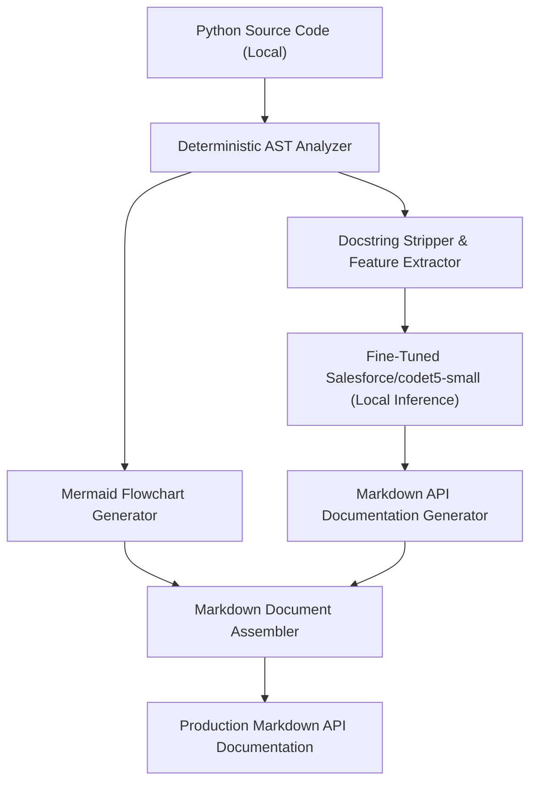

# CODEscribe — System Architecture & Engineering Baseline

## 1. System Overview

**CODEscribe** is an offline, privacy-first developer tool that accepts Python source code and automatically produces natural-language Markdown API documentation alongside deterministically generated Mermaid flowchart diagrams.



## 2. Frozen Specifications

- **Model Architecture:** `Salesforce/codet5-small` (encoder-decoder sequence-to-sequence).
- **Primary Task:** Supervised fine-tuning for Python code-to-documentation synthesis.
- **Diagram Generation:** Deterministic Python AST traversal (generating Mermaid flowcharts from function control flow; **not** hallucinated or predicted by CodeT5).
- **Privacy Architecture:** 100% local execution. No cloud API calls (no OpenAI, Gemini, Claude, etc.).
- **Dataset:** 10,000 CodeSearchNet-derived Python examples (`codesearchnet_10000_python_examples.csv`).

## 3. Directory Layout

```text
CODEscribe/
│
├── .gitignore                      # Git ignore rules for caches, weights, and raw datasets
├── requirements.txt                # Python package dependencies
│
├── data/
│   ├── raw/                        # Discovered raw dataset and reference archives
│   │   ├── codesearchnet_10000_python_examples.csv
│   │   └── CodeSearchNet-master.zip
│   └── processed/                  # Cleaned, deduplicated, and split datasets (Phase 2)
│       ├── train.csv               # 8,000 rows (80.00%, 3,113 unique repositories)
│       ├── validation.csv          # 1,000 rows (10.00%, 386 unique repositories)
│       ├── test.csv                # 1,000 rows (10.00%, 410 unique repositories)
│       └── dataset_manifest.json   # Machine-readable preprocessing provenance & SHA-256
│
├── training/
│   ├── __init__.py                 # Training module package definition
│   ├── config.py                   # Central PreprocessingConfig dataclass & parameters
│   ├── inspect_dataset.py          # Phase 1 dataset audit and profiling engine
│   └── prepare_dataset.py          # Phase 2 cleaning, deduplication & grouped splitting
│
├── outputs/
│   ├── dataset_inspection.txt      # Human-readable Phase 1 comprehensive audit report
│   ├── dataset_inspection.json     # Structured JSON Phase 1 audit report
│   ├── preprocessing_report.txt    # Human-readable Phase 2 preprocessing & split report
│   └── preprocessing_report.json   # Machine-readable Phase 2 manifest report
│
├── tests/
│   ├── test_inspect_dataset.py     # Unit test suite for Phase 1 inspection logic (14 tests)
│   └── test_prepare_dataset.py     # Unit test suite for Phase 2 preprocessing logic (17 tests)
│
└── docs/
    ├── architecture.md             # This architectural specification
    ├── dataset_audit_report.md     # In-depth technical Phase 1 audit report
    └── preprocessing_report.md     # In-depth technical Phase 2 preprocessing report
```

## 4. Execution & Verification Commands

### Phase 1: Dataset Inspection
```bash
python training/inspect_dataset.py
```

### Phase 2: Dataset Preprocessing & Group Splitting
```bash
python training/prepare_dataset.py
```

### Full Unit Test Suite (31 Tests)
```bash
python -m unittest discover -s tests -p "test_*.py" -v
```
