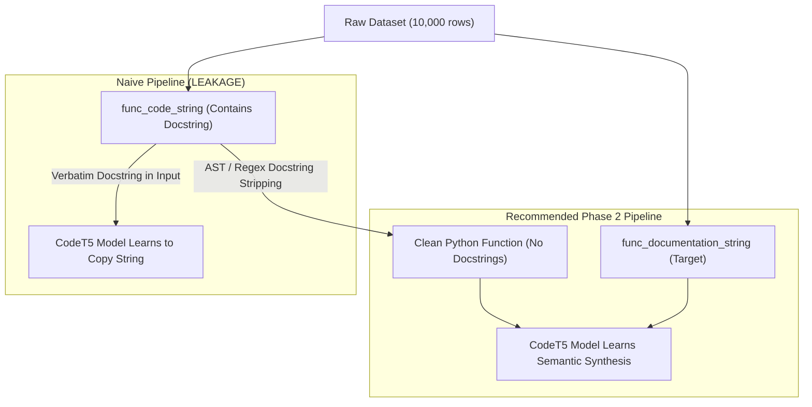

# CODEscribe — Phase 1 Dataset Audit & Engineering Baseline Report

**Project Title:** LLM-Based Automated Markdown API Documentation Generator from Source Code  
**Document Type:** Empirical Dataset Audit & Research Integrity Assessment  
**Audit Date:** October 2026  
**Environment:** Python 3.14.6 | Pandas 3.0.5 | Windows 11  
**Dataset Artifact:** `data/raw/codesearchnet_10000_python_examples.csv`  

---

## 1. Executive Summary

As part of **Phase 1** of project **CODEscribe**, an automated, reproducible inspection pipeline was engineered and executed against the raw dataset stored in `data/raw/`. The raw data file was discovered programmatically as `codesearchnet_10000_python_examples.csv` (originating from Hugging Face repository `espejelomar/code_search_net_python_10000_examples`, extracted from CodeSearchNet).

### Critical Findings Matrix

| Dimension | Observation | Impact / Engineering Decision |
| :--- | :--- | :--- |
| **Row / Column Volume** | 10,000 rows, 12 columns, 36.09 MB | Sufficient sample size for supervised fine-tuning of `Salesforce/codet5-small`. |
| **Completeness** | 0 nulls, 0 blanks across all 12 columns (100.0% populated) | High structural integrity; no record loss due to missing values. |
| **Code Representation** | `func_code_string` == `whole_func_string` in 10,000/10,000 rows (100%) | `func_code_string` has **not** been pre-stripped of inline docstrings. |
| **Target Leakage Risk** | **CRITICAL**: In 10,000/10,000 rows (100%), the target docstring is contained verbatim in the input code | Naive fine-tuning would cause the model to copy docstrings directly from code. **Docstring stripping is mandatory in Phase 2.** |
| **Language & Split** | 100% Python; 100% `train` partition | No pre-existing validation or test split exists in the raw CSV. Splitting must be engineered. |
| **Repository Clustering** | 3,909 unique repositories; top repo has 280 functions | Naive random train/val/test splitting will cause repository leakage. Grouped split required. |
| **Python AST Validity** | 9,937 / 10,000 (99.37%) valid Python 3 AST; 63 (0.63%) invalid | CodeSearchNet contains legacy Python 2 syntax (e.g. `print` without parens, octal literals). |
| **License & Provenance** | Multi-license GitHub harvesting (MIT, Apache, BSD, GPL, etc.) | License verification is mandatory before redistribution or research claims. |

---

## 2. Dataset Discovery & Physical Attributes

The dataset discovery module programmatically inspected `data/raw/`, avoiding hardcoded file paths while verifying that reference archives (such as `CodeSearchNet-master.zip`) were not misidentified as tabular data.

- **Discovered Path:** `data/raw/codesearchnet_10000_python_examples.csv`
- **File Size:** `37,847,891` bytes (~`36.09 MB`)
- **Row Count:** `10,000` records
- **Column Count:** `12` columns

### Column Schema and Inferred Types

| # | Column Name | Inferred Dtype | Missing (NaN) | Blank (Whitespace) | Completeness |
| :- | :--- | :--- | :-: | :-: | :-: |
| 1 | `Unnamed: 0` | `int64` | 0 | 0 | 100% |
| 2 | `repository_name` | `str` | 0 | 0 | 100% |
| 3 | `func_path_in_repository` | `str` | 0 | 0 | 100% |
| 4 | `func_name` | `str` | 0 | 0 | 100% |
| 5 | `whole_func_string` | `str` | 0 | 0 | 100% |
| 6 | `language` | `str` | 0 | 0 | 100% |
| 7 | `func_code_string` | `str` | 0 | 0 | 100% |
| 8 | `func_code_tokens` | `str` | 0 | 0 | 100% |
| 9 | `func_documentation_string` | `str` | 0 | 0 | 100% |
| 10 | `func_documentation_tokens` | `str` | 0 | 0 | 100% |
| 11 | `split_name` | `str` | 0 | 0 | 100% |
| 12 | `func_code_url` | `str` | 0 | 0 | 100% |

---

## 3. Deep Technical Audit Findings

### 3.1 Code Column Comparison & Target Leakage Detection

In the CodeSearchNet specification, `whole_func_string` designates the complete function definition (including comments, annotations, and docstrings), whereas `func_code_string` in some corpora attempts to provide the code body with documentation stripped.

**Audit Discovery:**
1. In this specific Hugging Face release, `func_code_string` and `whole_func_string` are **identical for 10,000 out of 10,000 rows (100.0%)**.
2. Verification reveals that `func_documentation_string` exists **verbatim inside `func_code_string` for 10,000 out of 10,000 rows (100.0%)**.

**Recommendation:**  
Substituting `whole_func_string` for `func_code_string` accomplishes nothing because they are identical. Neither column is suitable for raw training as-is. In **Phase 2**, an AST-based or robust token-based transformation must remove the docstring from the input code to establish a valid supervised learning objective.

### 3.2 Duplicate Analysis

- **Unique Code Strings:** `10,000` (0 duplicate code implementations)
- **Unique Documentation Strings:** `9,894` (`106` duplicate docstrings)
- **Unique Code-Doc Pairs:** `10,000` (0 duplicate pairs)

The 106 duplicate docstrings represent conventional Python conventions repeated across independent libraries (e.g., `"Return string representation."`, `"Initialize instance."`, `"Close active connection."`). These do not represent dataset corruption.

### 3.3 Sequence Length and Percentile Profiling

To ensure compatibility with the token limits of `Salesforce/codet5-small` (maximum sequence length typically 512 tokens), character and line length distributions were evaluated:

| Metric | Source Code (`func_code_string`) | Target Documentation (`func_documentation_string`) |
| :--- | :--- | :--- |
| **Min Chars** | 100 | 1 |
| **Max Chars** | 30,293 | 15,020 |
| **Mean Chars** | 1,054.0 | 297.0 |
| **Median Chars (P50)** | 678.0 | 142.0 |
| **P75 Chars** | 1,224.0 | 346.3 |
| **P90 Chars** | 2,155.1 | 683.1 |
| **P95 Chars** | 3,116.3 | 1,023.1 |
| **P99 Chars** | 6,020.0 | 2,320.1 |
| **Median Lines** | 18 lines | 4 lines |

**Implication for Fine-Tuning:**  
At P90, code is ~2,155 characters (~450-550 BPE tokens). A small subset of outlier functions (P99 at 6,020 chars, max at 30,293 chars) will exceed the 512-token context window of CodeT5-small. Truncation and outlier filtering criteria must be codified during Phase 2 preprocessing.

### 3.4 Python Syntax & AST Conformity

Every record was parsed using Python's standard library `ast.parse`:
- **Valid Python AST:** `9,937` (`99.37%`)
- **Invalid Python AST:** `63` (`0.63%`)

**Error Breakdown for the 63 Failures:**
1. `Missing parentheses in call to 'print'` (43 instances) — Legacy Python 2 code.
2. `invalid syntax` (11 instances) — Python 2 `except Exception, e:` or syntax oddities.
3. `leading zeros in decimal integer literals are not permitted` (2 instances) — Python 2 octal syntax (e.g. `0755`).
4. `inconsistent use of tabs and spaces in indentation` (3 instances).
5. `'u' and 'r' prefixes are incompatible` (1 instance).

**Recommendation:**  
Filter out or clean the 63 legacy Python 2 instances during Phase 2 preprocessing to guarantee that downstream AST flowchart generation and CodeT5 tokenization operate on standard Python 3.

### 3.5 Single Split & Repository Leakage Warnings

1. **Single Split Warning:**  
   The dataset has only `train` marked in `split_name` (`10,000` records). No predefined validation or test sets are present.
2. **Repository Clustering & Data Leakage:**  
   There are `3,909` unique repositories. However, functions are not uniformly distributed. The top 5 repositories are:
   - `saltstack/salt`: 280 functions (2.80%)
   - `mitsei/dlkit`: 65 functions (0.65%)
   - `materialsproject/pymatgen`: 57 functions (0.57%)
   - `brocade/pynos`: 54 functions (0.54%)
   - `gem/oq-engine`: 46 functions (0.46%)

   If records are randomly split across train/validation/test partitions, functions from `saltstack/salt` will appear across both training and test sets. This creates **repository-level data leakage**, inflating test ROUGE/BLEU scores because the model memorizes repository-specific helper names, coding styles, and argument nomenclature. A grouped split by repository is strongly advised in Phase 2.

### 3.6 License and Provenance Notice

The raw CSV derives from `espejelomar/code_search_net_python_10000_examples`, extracted from the public CodeSearchNet corpus mined by GitHub/Microsoft. While CodeSearchNet targeted open-source repositories, repositories exhibit a mix of licenses (MIT, Apache 2.0, BSD, GPL, MPL). Proper citation, license disclaimers, and academic attribution must accompany all future releases and documentation.

---

## 4. Engineering Deliverables Summary

- **Inspection Script:** `training/inspect_dataset.py` (CLI, robust pandas parsing, type annotations, automated directory creation)
- **Unit Test Suite:** `tests/test_inspect_dataset.py` (14 passing tests covering discovery, blank handling, duplicate counting, AST parsing, and error paths)
- **Outputs Produced:**
  - `outputs/dataset_inspection.txt` (Human-readable audit report)
  - `outputs/dataset_inspection.json` (Structured JSON machine-readable metrics)
- **Project Structure:**
  - `data/processed/` (Ready for Phase 2 cleaned datasets)
  - `requirements.txt` (Documenting core and upcoming dependencies)
  - `.gitignore` (Configured for Python, checkpoints, caches, and raw/processed datasets)
