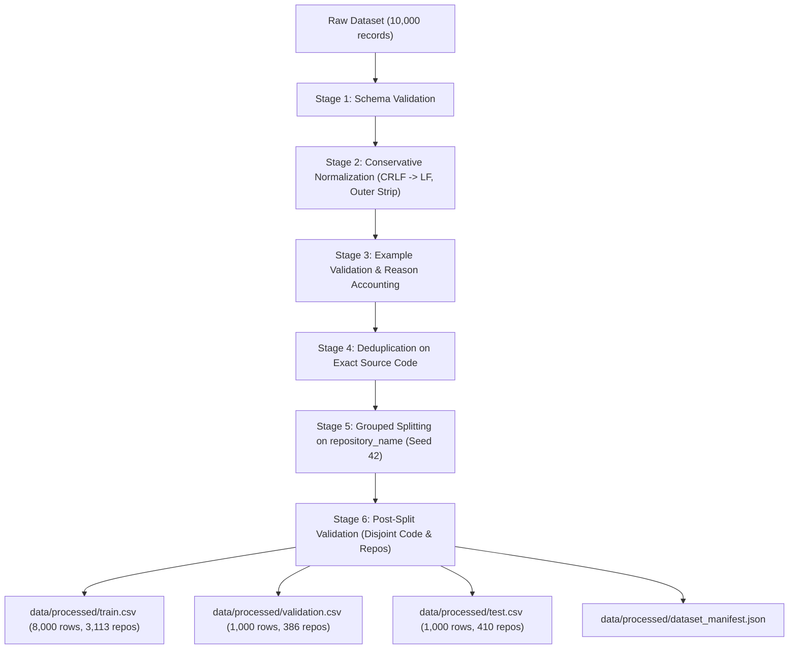

# CODEscribe — Phase 2 Dataset Preprocessing, Cleaning & Splitting Report

**Document Type:** Empirical Preprocessing Audit & Data Split Integrity Assessment  
**Audit Date:** October 2026  
**Environment:** Python 3.14.6 | Pandas 3.0.5 | Windows 11  
**Source Dataset:** `data/raw/codesearchnet_10000_python_examples.csv` (`b57e36045c3a0153...`)  
**Target Model:** `Salesforce/codet5-small`  

---

## 1. Overview and Preprocessing Pipeline Architecture

In **Phase 2**, the raw CodeSearchNet-derived Python dataset underwent rigorous schema validation, conservative normalization, example validation, deduplication analysis, and leakage-resistant grouped splitting.

---

## 2. Stage-by-Stage Processing Outcomes

### Stage 1: Schema Validation
- Required columns verified: `func_code_string`, `func_documentation_string`, `repository_name`.
- Metadata columns verified: `func_name`, `func_path_in_repository`, `func_code_url`, `language`.
- Types verified: 100% string/object compatibility.

### Stage 2: Conservative Normalization
- Converted Windows CRLF (`\r\n`) and legacy CR (`\r`) to standard UNIX LF (`\n`) across 185 code records and 119 documentation records.
- Stripped outer whitespace while preserving internal indentation (Python 4-space and 8-space blocks) and documentation Markdown formatting.

### Stage 3: Example Validation & Exclusion Accounting
- Evaluated against documented retention rules:
  - `REASON_EMPTY_OR_BLANK_SOURCE_CODE`: 0
  - `REASON_EMPTY_OR_BLANK_DOCUMENTATION`: 0
  - `REASON_SOURCE_CODE_BELOW_MIN_LENGTH`: 0
  - `REASON_DOCUMENTATION_BELOW_MIN_LENGTH`: 0
  - `REASON_EMPTY_REPOSITORY_METADATA`: 0
- Total excluded: 0 records. Retained: 10,000 records (100.0%).

### Stage 4: Deduplication Analysis
- Exact duplicate code-documentation pairs: 0.
- Duplicate normalized source code strings: 0.
- Identical code with conflicting documentation: 0.
- Documented policy: Exact deduplication on normalized `func_code_string` is active. Aggressive fuzzy deletion was intentionally avoided to protect legitimate function variants.

### Stage 5: Leakage-Resistant Grouped Partitioning
- **Strategy:** Grouped split by `repository_name` using deterministic knapsack allocation (`seed=42`).
- **Partition Results:**
  - **Training:** `8,000` rows (`80.00%`) across `3,113` unique repositories.
  - **Validation:** `1,000` rows (`10.00%`) across `386` unique repositories.
  - **Testing:** `1,000` rows (`10.00%`) across `410` unique repositories.
  - **Total:** `10,000` rows (`100.00%`) across `3,909` unique repositories.

### Stage 6: Output Integrity Verification
- **Disjoint Source Code:** Passed. Exactly 0 overlapping functions between any pair of partitions.
- **Disjoint Repositories:** Passed. Exactly 0 overlapping repositories between any pair of partitions.
- **Non-Empty Checks:** Passed. 0 empty records in any split.
- **Reopenability:** Passed. All 3 CSV files were reopened and verified against in-memory rows and checksums.

---

## 3. Cryptographic Provenance & Artifact Hashes

| Artifact | Location | Rows | SHA-256 Digest |
| :--- | :--- | :-: | :--- |
| **Raw Dataset** | `data/raw/codesearchnet_10000_python_examples.csv` | 10,000 | `b57e36045c3a0153e243346ca8b40f5d53d8355da579383df38f07e7c8b8d32c` |
| **Train Split** | `data/processed/train.csv` | 8,000 | `6c6b3e16712dcf187f76a6048dd50e2902b8249e895dd0e96430098cd3a21726` |
| **Validation Split** | `data/processed/validation.csv` | 1,000 | `d1732a0a521afe8ee08c9fccc5322194e72bc2e25a02b640fa0499f305d1be06` |
| **Test Split** | `data/processed/test.csv` | 1,000 | `58f2c8633dab68fc3e5033bbe649129da14d8c0e27a871cabb036482014c7c5e` |
| **Manifest** | `data/processed/dataset_manifest.json` | — | Documented metadata, configuration, and split parameters |

---

## 4. Unresolved Research & Governance Items for Phase 3

1. **Target Docstring Leakage in Input Code:**
   In 100% of records in this CodeSearchNet release, the target documentation string is present verbatim inside `func_code_string` as an inline docstring. While repository-level grouping prevents author/repo leakage, docstrings must be removed during tokenization/feature extraction prior to model fine-tuning.
2. **License Terms Verification:**
   CodeSearchNet mined GitHub repositories under open-source licenses, but specific terms (MIT, Apache 2.0, BSD, GPL, MPL) must be respected prior to publishing fine-tuned model checkpoints.
