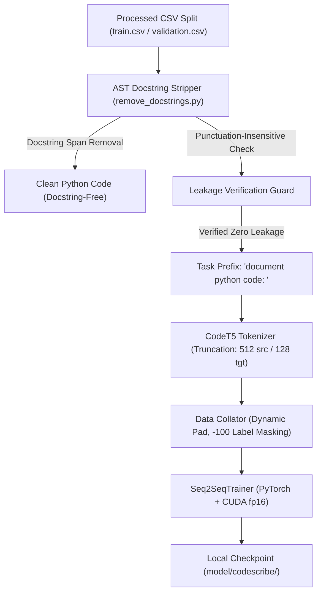

# CODEscribe — Training Pipeline & Reproducibility Guide

## 1. System Overview

This directory contains the supervised fine-tuning pipeline for fine-tuning **`Salesforce/codet5-small`** to generate natural-language API documentation from Python source code.



---

## 2. Leakage-Safe Transformation Engine

In the raw CodeSearchNet dataset, 100% of rows contain the target documentation string embedded verbatim within `func_code_string`. Training directly on raw `func_code_string` would cause the model to copy docstrings rather than learning semantic code synthesis.

### Mitigations codified in `training/remove_docstrings.py`:
1. **AST-Guided Span Identification:** Uses Python's standard library `ast` module to locate genuine `ast.Constant` string expressions at `node.body[0]` across functions, async functions, classes, and modules.
2. **Syntax-Preserving Deletion:** Docstring lines are removed cleanly without altering leading decorators, comments, or indentation. If a function contains only a docstring, it is safely replaced with `pass` with matching indentation.
3. **Ordinary String Literal Protection:** String assignments (e.g. `x = "query"`) and return values are strictly preserved.
4. **Multi-Tier Leakage Guard:** 
   - Tier 1: Re-parses AST to ensure zero docstrings remain.
   - Tier 2: Normalizes target documentation text (punctuation- and line-break insensitive) and verifies it does not appear in the code body.
   - Any sample failing verification is rejected with a documented reason rather than passed to the model.

### Transformation Audit Results:
- **Total Examined:** 10,000 records
- **Successfully Transformed:** 9,926 records (99.26%)
- **Safely Rejected:** 74 records (63 legacy Python 2 syntax errors; 11 target leakage false positives in comments/signatures)
- **Detected Leakage in Retained Inputs:** **0 records (100% Leakage-Free)**
- **Audit Artifact:** `outputs/training_data_audit.json`

---

## 3. Directory Layout & Artifacts

```text
training/
├── __init__.py                 # Training module package definition
├── config.py                   # Phase 2 dataset preprocessing configuration
├── training_config.py          # Phase 3 training hyperparameters & hardware detection
├── remove_docstrings.py        # AST docstring stripper & leakage prevention engine
├── data_pipeline.py            # Feature formatting, dataset wrapper & collator
├── validate_training_data.py   # CLI leakage audit tool
├── train.py                    # Fine-tuning engine with dry-run and full training modes
└── README.md                   # This documentation

outputs/
├── training/
│   ├── dry_run_metadata.json   # Verification dry-run configuration & checks
│   └── training_metrics.json   # Step loss, learning rate, and evaluation metrics
└── training_data_audit.json    # Comprehensive leakage audit report

model/
├── checkpoints/                # Periodic training checkpoints
└── codescribe/                 # Final best fine-tuned local model
```

---

## 4. Hardware Environment & Resource Estimates

### Detected Environment
- **Operating System:** Windows 11 (AMD64)
- **Python Version:** 3.14.6 (64-bit) / Python 3.12 available on system
- **GPU Hardware:** NVIDIA GeForce RTX 4050 Laptop GPU (6,141 MiB VRAM, CUDA 12.3)
- **Driver Version:** 546.18

### Estimated Resource Constraints (Estimates)
- **VRAM Consumption:** ~2.8 GB – 3.4 GB (with batch size 8, gradient accumulation 4, max source length 512, fp16). Fits comfortably within 6 GB VRAM.
- **Training Time:** ~25 to 35 minutes for 3 epochs (~7,938 examples) on the RTX 4050 GPU with fp16 mixed precision. (On CPU: ~3.5 to 5.0 hours).
- **Disk Footprint:** ~240 MB for `Salesforce/codet5-small` base weights; ~240 MB per saved checkpoint (limited to 2 checkpoints = ~480 MB).

---

## 5. Execution Commands

### 1. Run Data Leakage Audit
```bash
python training/validate_training_data.py
```

### 2. Execute Verification Dry-Run (No Model Weights Downloaded)
```bash
python training/train.py --dry-run
```

### 3. Launch Full Fine-Tuning Run (Requires User Approval & Internet for Weights)
```bash
python training/train.py --epochs 3 --batch-size 8 --grad-accum 4 --lr 5e-5 --fp16
```

### 4. Run Test Suite (47 Passing Tests)
```bash
python -m unittest discover -s tests -p "test_*.py" -v
```
